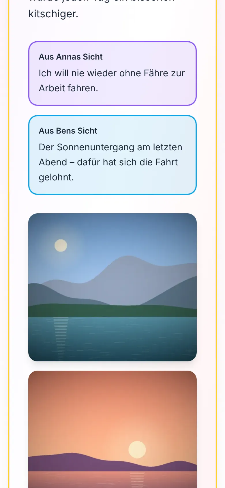

# Storybook

A private, self-hosted photo journal for an arbitrary amount of people: memories with photos, places and moods on a shared timeline, installable on the phone like an app. I run it on a small Ubuntu server, which is hardened and monitored by its own repository, [dk-srv](https://github.com/DimiJonas/dk-srv).

The app's interface is in German (it's made for German speakers); the code, comments and docs are
in English.

  
  
  
  

Screenshots of a demo storybook: invented people and memories, generated pictures.

## What it does

- **Timeline** of memories (single days or several days) with photos, mood emoji, tags and places;
  "Kapitel" (chapters of life) group them; text search, and filters by mood, year, Kapitel and photos
- **Two voices:** everyone edits the shared text, and each person can add their own perspective;
  every change goes into a history ("Änderungshistorie")
- **Photos:** upload from the phone, choose order and cover photo, album view, full-screen viewer;
  small versions are made on the server
- **Map** of all places (OpenStreetMap, place search via Nominatim); a photo's GPS position becomes
  its town, and is then removed from the file
- **Yearly review** ("Unser Jahr"): numbers, highlights, month by month, places, moods
- **Several storybooks** per installation (e.g. a couple's and a family one)
- **Installable** as a progressive web app (home screen icon, opens full screen)

## Components

| Part    | Technology                                                  |
| ------- | ----------------------------------------------------------- |
| App     | React, Vite, Tailwind CSS, Leaflet; a PWA (`client/`)       |
| Backend | Node.js, Express, PostgreSQL , sharp for images (`server/`) |
| Server  | Ubuntu, nginx, pm2, shell scripts (`ops/`); the server itself: [dk-srv](https://github.com/DimiJonas/dk-srv) |

Database changes are plain SQL migrations (`server/migrations/`); `schema.sql` is a snapshot of the
current structure.

## Security

Security was a main goal. The app holds private photos and texts, so it's built to be locked
down by default, and the server watches itself. **[`docs/SECURITY.md`](docs/SECURITY.md)** maps
every measure of the app to the guide it comes from – OWASP ASVS 5.0, the OWASP Top 10 and the CIS
NGINX Benchmark – with the risks accepted on purpose. The server is hardened by the CIS Benchmarks
for Ubuntu, nginx and PostgreSQL in its own repository, **[dk-srv](https://github.com/DimiJonas/dk-srv)**:
the CIS Level 1 score (Ubuntu's own audit tool) went from **72.2 %** before the hardening to
**92.7 %** of all rules – **100 %** without the 13 risks accepted on purpose, each with its reason –
and its `HARDENING.md` explains every mechanism: what, why, and how to check it yourself.

**The app and nginx**

- **Login:** a cookie that scripts can't read (`__Host-` prefix, HttpOnly, Secure,
  SameSite=Strict). The database stores only a hash of it, so a backup contains no usable logins.
- **Protection against guessing:** failed logins wait longer each time, per IP and per account.
  nginx also rate-limits the login, and fail2ban bans IPs that keep hammering it or scanning for
  holes.
- **Strict security headers:** a Content-Security-Policy with no inline scripts or styles, plus
  HSTS, no framing and a restrictive Permissions-Policy.
- **Uploads:** only real images are accepted (file name and content are checked), and they get
  random names. GPS positions are removed from photos.
- **Backend:** reachable only from nginx on the same machine. It refuses to start without proper
  secrets and the site's address.
- **Map tiles:** fetched through nginx and cached there, so OpenStreetMap never sees who looks at
  which area.

**Running it** (the server's part: [dk-srv](https://github.com/DimiJonas/dk-srv))

- **Only root can change what root runs:** everything of the storybook that runs as root is in one
  folder, [`ops/root/`](ops/root/); the server installs it from its own root-owned copy, never from
  the app's folder.
- **Nightly security check** (dk-srv) looks for known vulnerabilities in the app's npm
  dependencies and Node.js, and in internet-facing packages. For a critical one it switches the
  storybook to its **maintenance page** (`storybook-mode`) – or the whole web server into lockdown.
- **Phone notifications** (ntfy) for locked accounts, failed backups and restore tests – plus the
  server's: SSH connections, banned attackers, unexpected file changes, security findings, a weekly
  report.
- **Encrypted nightly backups** (age; the server can't read its own backups), fetched by a second
  machine with a key that may only read them, and a **monthly automatic restore test**.

## Documentation

- [dk-srv's `setup-commands.txt`](https://github.com/DimiJonas/dk-srv/blob/main/setup-commands.txt) - securing a fresh Ubuntu server (do this first)
- [`project_setup_commands.txt`](project_setup_commands.txt) - setting up the storybook on a server, step by step
- [`project_maintenance_commands.txt`](project_maintenance_commands.txt) - everyday commands: deploying, backups,
  users, maintenance mode, emergencies
- [`ops/README.md`](ops/README.md) - background on operations (backups, migrations, security, logs, what root runs)
- [`server/README.md`](server/README.md) - the backend: settings, API, database changes
- [`client/README.md`](client/README.md) - the app: commands, where things are
- [`docs/SECURITY.md`](docs/SECURITY.md) – every security measure of the app, the guide it comes from, and the accepted risks
- [`ROADMAP.md`](ROADMAP.md) - how it was built, step by step, with the decisions behind each step

In the commands, `storybook.example.com` stands for your own domain.

**Running it locally:** PostgreSQL, then `server/.env` (see `server/README.md`),
`cd server && npm ci && npm run migrate && npm run dev`, and in a second terminal
`cd client && npm ci && npm run dev` -> http://localhost:3000.

## Status

A personal project in daily use. Next idea: a printable storybook (a year as a laid-out PDF for a
photo book) - see `ROADMAP.md`.

© All rights reserved. The code is public to read; there is no license for reuse.
